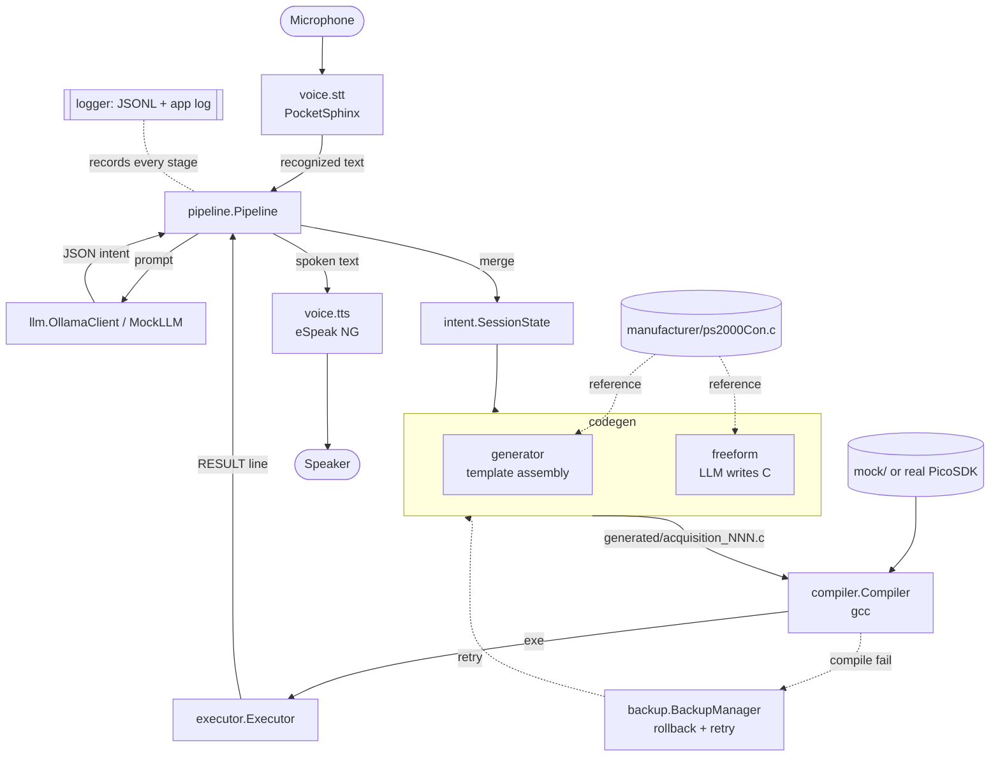
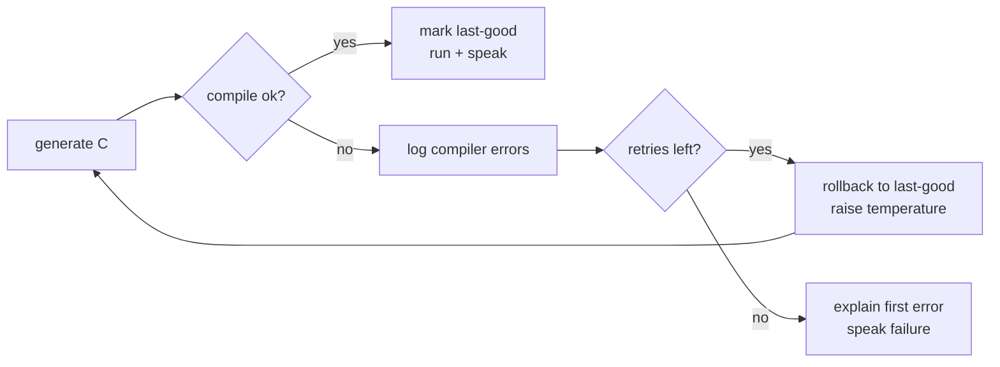

# Architecture

PicoWave Assistant is a staged pipeline. Each stage is a small, independently
testable module under `src/picowave/`, and every stage emits a structured log
event. This document describes the components, the data flow, and the two code
generation strategies.

## Component map

## Data flow, stage by stage

1. **STT** (`voice/stt.py`) — PocketSphinx with a JSGF grammar
   (`config/grammar.jsgf`) constrains recognition to the command vocabulary.
   Falls back to typed stdin when no mic/engine is present.
2. **Intent** (`llm/` + `intent.py`) — the recognised text plus current settings
   go to the LLM with a *schema-only* system prompt; the reply is parsed into an
   `Intent(action, params, confidence, notes)`.
3. **State merge** (`intent.SessionState`) — `params` overlay a persistent state
   object, then everything is clamped to device-safe bounds. This is what makes
   "set trigger level" then "acquire" compose correctly.
4. **Code generation** (`codegen/`) — for a runnable action (`acquire`/`siggen`/
   `arb`) a new `generated/acquisition_NNN.c` is written (id is monotonic; files
   are never overwritten).
5. **Compile** (`compiler/builder.py`) — `gcc` builds it against the mock or real
   SDK; stdout/stderr/exit code captured.
6. **Execute** (`executor/runner.py`) — the binary runs in `generated/`, captures
   output, and extracts the `RESULT:` summary line and device status.
7. **TTS** (`voice/tts.py`) — eSpeak NG speaks the summary; always mirrored to
   the console.

## Two code-generation strategies

### Template mode (default, `--mode template`)

`codegen/generator.py` fills one of three manufacturer-derived templates
(`templates/acquire.c.tmpl`, `siggen.c.tmpl`, `arb.c.tmpl`) with values from the
session state. Only real `ps2000_*` calls are emitted, so **compilation cannot
fail from hallucinated APIs**. Each generated file is self-contained and carries
the originating voice command + resolved intent JSON in its header comment.

### Freeform mode (opt-in, `--mode llm-freeform`)

`codegen/freeform.py` gives the model a compact reference (the list of available
`ps2000_*` functions + the `collect_block_immediate` usage pattern extracted from
the manufacturer file) and asks it to write the whole program. Because this can
produce non-compiling code, it runs inside a loop:

## The manufacturer boundary

`manufacturer/` is copied verbatim from the uploaded `ps2000` package and is
never modified. The templates *reproduce the manufacturer's call sequences*
(open → set_channel → set_trigger → get_timebase → run_block → ready → stop →
get_times_and_values → close), so generated programs behave like the vendor
example with parameters swapped in. Nothing in the manufacturer logic is
replaced or reinvented.

## Mock vs real SDK

`mock/libps2000/ps2000.h` is a faithful *subset* of the real header, and
`mock/ps2000_mock.c` returns synthetic data. Generated sources are **identical**
in mock and real builds — only the compiler's include/link flags differ — so a
program proven against the mock also builds and runs on the real target.

## Logging

`logger.py` writes two sinks: a human-readable `logs/picowave.log` and a
structured `logs/session-<ts>.jsonl` with one event per stage
(`recognized_text`, `llm_prompt`, `llm_raw_reply`, `intent`, `state`,
`generated_code`, `compile`, `execute`), each timestamped — satisfying the full
logging requirement and making every run reproducible/inspectable.
