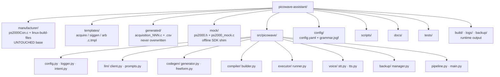
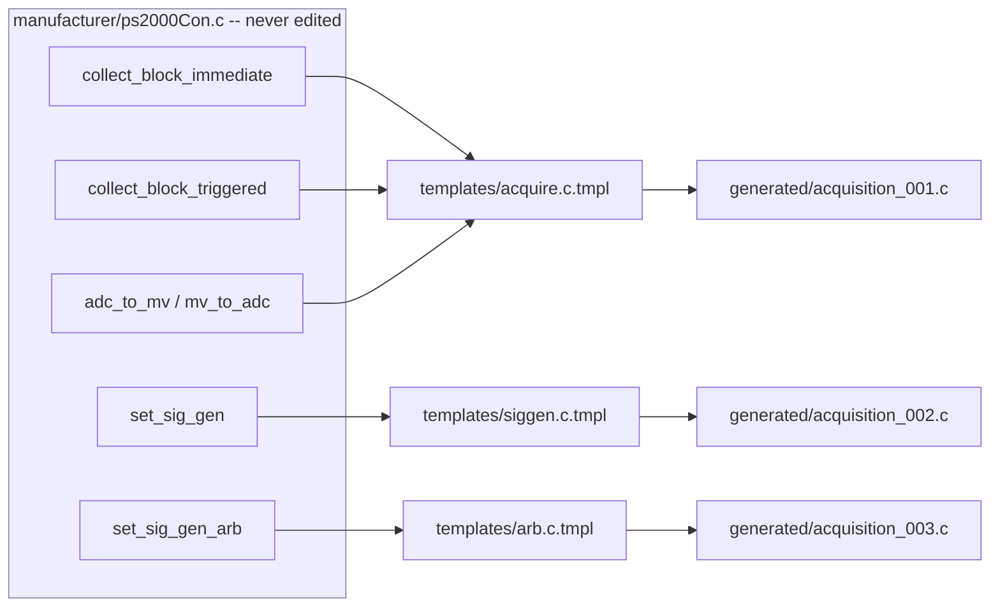

# Project Structure Diagrams

## Directory tree



## Manufacturer → template → generated relationship



The templates reproduce the manufacturer's exact `ps2000_*` call sequences; the
generator only substitutes parameters (channel, range, trigger, timebase,
waveform, frequency, amplitude, offset). No manufacturer code is rewritten and no
new PicoSDK APIs are invented.
```
